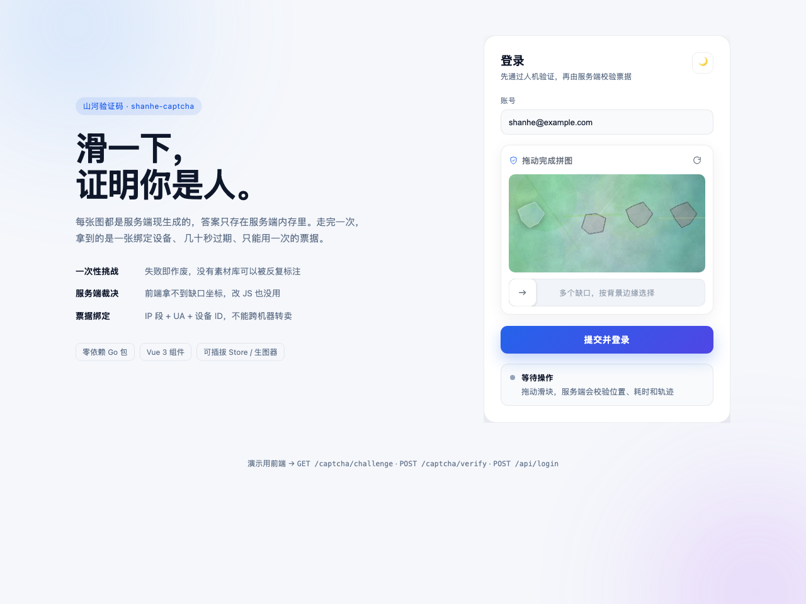

# 山河验证码

滑块验证码。前端 Vue 3，后端 Go（标准库，零第三方依赖），Rust 后端计划中。

图片在服务端生成，缺口坐标只存在服务端。前端拖动、采集轨迹、解一道 PoW 小题，通过后拿一张绑定客户端的一次性票据，业务接口消费即作废。



## 功能

- 每次请求生成新图，不用固定图库；默认 3 个假缺口，第一个与真缺口同排
- 下发碎片经过形变、模糊、色偏，不能直接当模板去背景里匹配
- 拖动轨迹检查、行为评分、按 IP 段限流、PoW（默认开启 18 bit）
- 可选第二道无图滑块
- 一次性票据绑定 IP 段 + UA + 设备标识，60 秒过期，消费即作废
- 存储、限流器、图片生成器都是可替换接口，多实例接共享存储
- 反向代理按可信网段解析 X-Forwarded-For
- Vue 组件样式限定在自身根节点内，不污染宿主页面

## 目录

| 路径 | 内容 |
| --- | --- |
| `frontend/` | Vue 3 组件、示例页和 npm 包 |
| `backend-go/` | Go 后端，独立模块 |
| `backend-rust/` | Rust 后端，计划中 |
| `docs/` | 文档截图 |

## 跑起来

```bash
cd frontend
npm install
npm run build:demo

cd ../backend-go
go run ./example
```

打开 <http://127.0.0.1:8090>。示例页走拖动、校验、票据、登录消费的完整流程。带链路观察、轨迹回放、事件流和内嵌文档的展示站在独立项目 shanhe-captcha-demo 维护，不进本仓库。

## 文档

- [Go 后端](backend-go/README.md)：接口、配置、部署形态、存储与限流扩展
- [Vue 组件](frontend/README.md)：属性、事件、主题变量、文案

## 协议

MIT